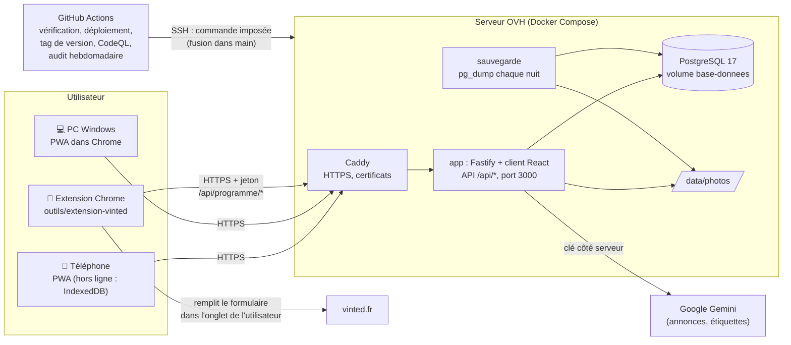
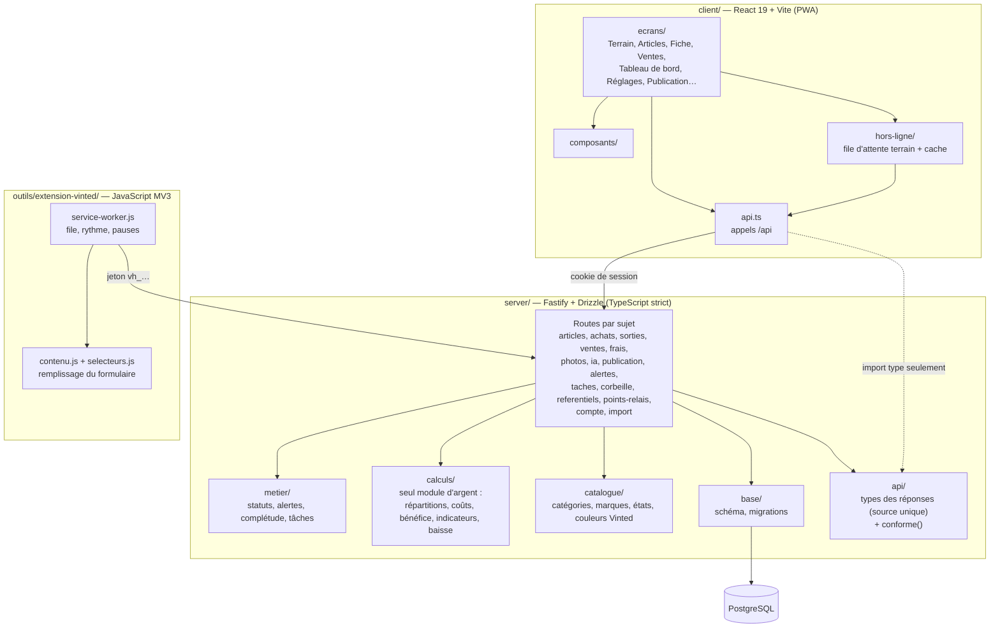
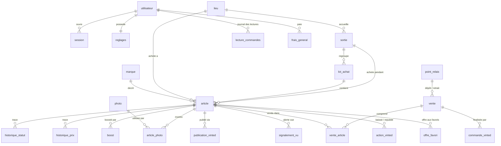

# Architecture de Vinted Helper

Trois vues : l'ensemble (qui parle à qui), le découpage du code, puis le modèle de données. Les schémas sont en
Mermaid : GitHub les affiche directement.

> À jour pour la version **1.31.1**. Ce document est relu et mis à jour à chaque nouvelle version (`/version`).

## 1. Vue d'ensemble

- L'extension publie les annonces sur Vinted ; le serveur n'appelle pas Vinted (la règle n° 4 qui limitait
  l'automatisation de Vinted a été retirée le 14/10/2026, #185).
- La clé Gemini ne quitte pas le serveur (règle n° 3).
- Sur le PC de développement, le même `docker-compose.yml` tourne avec Caddy en HTTPS local (Wi-Fi de la maison).

## 2. Découpage du code

Noms des dossiers (#246) :

| Dossier | Contenu |
|---|---|
| `outils/extension-vinted/` | L'extension Chrome (chargée dans Chrome depuis ce dossier : son nom ne change pas) |
| `server/src/utilitaires/`, `client/src/utilitaires/` | Fonctions utilitaires (erreurs, validation, formats, montants, dates…) |
| `server/src/commandes/` | Commandes lancées à la main (`npm run reset-password`, `import-tableur`, `photos:sans-metadonnees`, `doc:categories`) |
| `server/src/test/`, `server/navigateur/` | Outils des tests (base en mémoire, parcours dans Chromium) |

« Extension » est le seul nom du logiciel de publication ; les routes qu'elle appelle gardent leur ancien nom
`/api/programme/*` (programme du PC retiré, ADR-0036) pour ne pas casser la publication entre deux mises à jour.

## 3. Modèle de données

Chaque table (sauf `utilisateur`) porte un `utilisateur_id`, omis ici pour la lisibilité. Les montants sont en
centimes ; les parts calculées ne sont jamais stockées (règle n° 2).

| Table | Rôle |
|---|---|
| `sortie`, `lieu` | Un vide-grenier (date, lieu, essence) |
| `lot_achat` | Plusieurs articles achetés ensemble pour un prix global |
| `article` | L'objet : prix d'achat, prix affiché, statut, annonce, catégorie Vinted ; créé par photos : état du remplissage par l'IA (#276) |
| `photo`, `article_photo` | Photos (fichiers dans `data/photos`) et leur ordre sur l'article |
| `historique_statut`, `historique_prix`, `boost` | Suivi dans le temps |
| `vente`, `vente_article` | Une vente (simple ou groupée), retours compris |
| `point_relais` | Points relais saisis par l'utilisateur (#210) : horaires, page officielle ; point de dépôt et de retrait d'une vente |
| `frais_general` | Frais divers hors articles |
| `publication_vinted` | File d'attente de l'extension et résultat de chaque publication (échec d'une vraie publication → article au statut Erreur) |
| `signalement_vu` | Alertes « Pour info » de l'écran « À faire » marquées « Vu » (#191), avec leur date de départ |
| `action_vinted` | Actions des tâches automatiques (#147) : baisse de prix ou republication d'un article dormant, à valider, puis faites par l'extension |
| `commande_vinted` | Commandes terminées lues sur Vinted (#148), rattachées à une vente (à valider, à rattacher, appliquées) |
| `offre_favori` | Offres réduites aux personnes qui ont mis un article en favori (#149) : une par personne (empreinte, jamais le nom) et par article ; effacées après 6 mois |
| `lecture_commandes` | Journal des lectures du « Porte-monnaie » (#233) : nombres lus et traités, ou raison de l'erreur ; effacé après 3 mois |
| `reglages`, `session`, `marque` | Paramètres de calcul et des tâches automatiques, connexions, marques |
